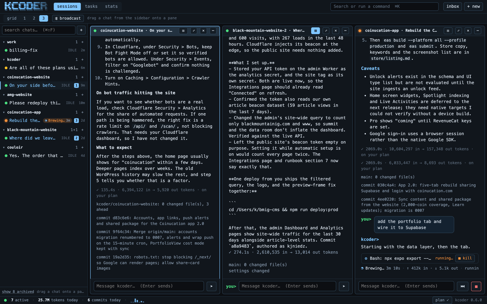
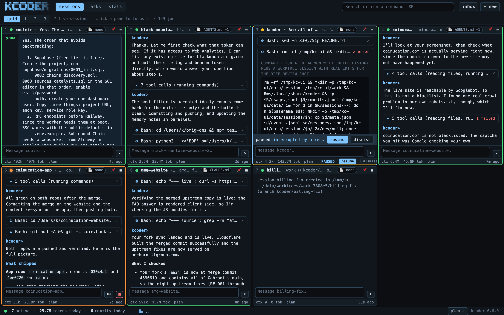
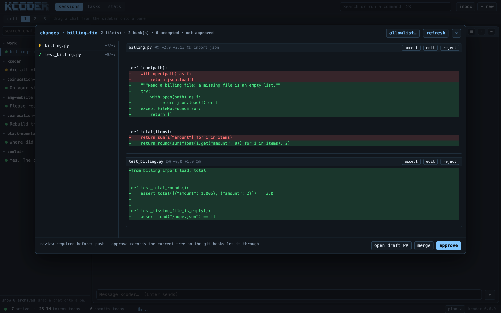
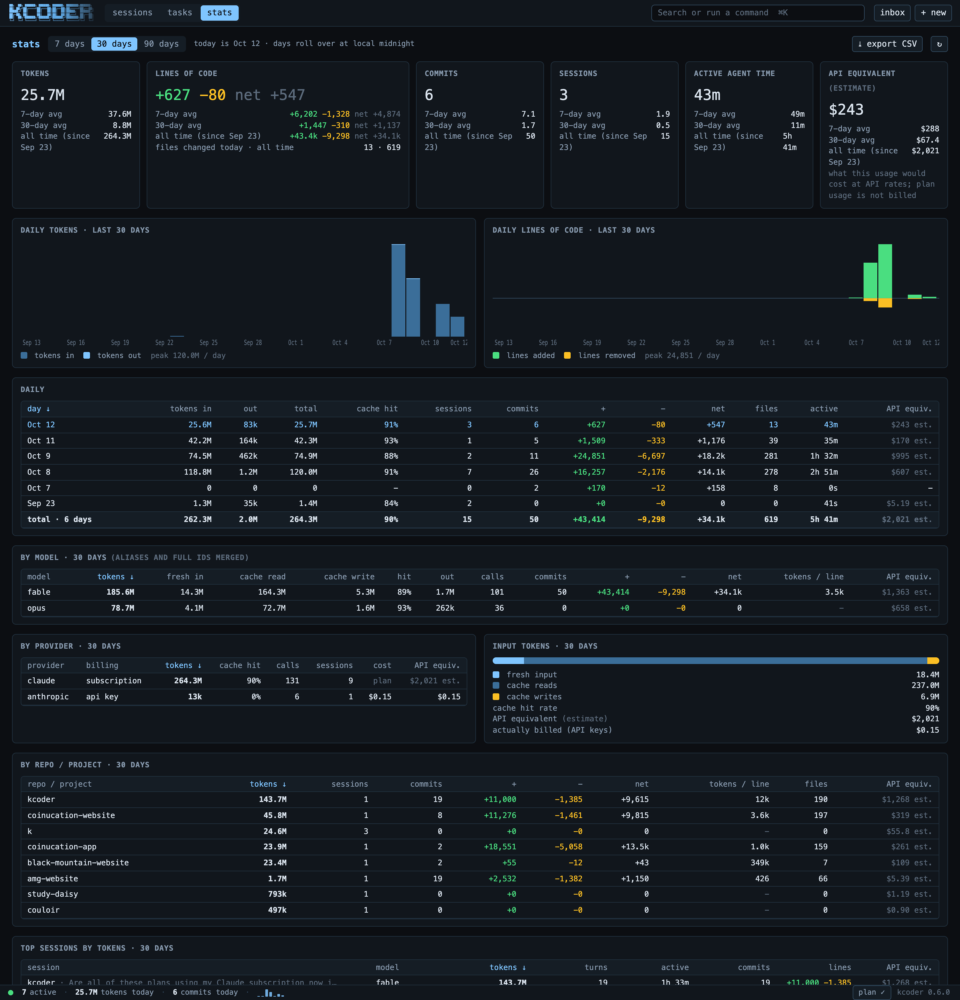

# kcoder

```
██╗  ██╗ ██████╗ ██████╗ ██████╗ ███████╗██████╗
██║ ██╔╝██╔════╝██╔═══██╗██╔══██╗██╔════╝██╔══██╗
█████╔╝ ██║     ██║   ██║██║  ██║█████╗  ██████╔╝
██╔═██╗ ██║     ██║   ██║██║  ██║██╔══╝  ██╔══██╗
██║  ██╗╚██████╗╚██████╔╝██████╔╝███████╗██║  ██║
╚═╝  ╚═╝ ╚═════╝ ╚═════╝ ╚═════╝ ╚══════╝╚═╝  ╚═╝
```

**kcoder runs several coding agents at once on your own computer**, on your
Claude subscription, each in its own copy of a project, and shows you all of
them in one window. Developed by Kyle Niedzwiecki.

- Every session reads and writes files and runs commands in a real folder on
  your machine; nothing is simulated.
- Sessions live in a small background service (`kcoderd`), so they keep
  working when you close the window, and you can watch them from the app or
  from a terminal.
- Claude sessions run on your Claude plan only. kcoder never uses an API key
  or extra-usage credits for them: at a plan limit the turn stops.
- Each session works on its own git branch in its own worktree, with a diff
  review, secret scanning, checkpoints you can undo to, and one-click
  draft PRs, all as your own GitHub account.



<table>
<tr>
<td width="33%"><br><sub><b>Sessions</b>: every live session as a pane, or 1 to 3 side by side</sub></td>
<td width="33%"><br><sub><b>Diff review</b>: accept, edit or reject each hunk, then approve, merge or open a PR</sub></td>
<td width="33%"><br><sub><b>Stats</b>: tokens, lines of code, commits, cache use, activity</sub></td>
</tr>
</table>

## Contents

1. [Get kcoder](#get-kcoder) (Mac, Windows, Linux)
2. [First run](#first-run) (connect your Claude plan and GitHub)
3. [The app](#the-app) (sessions, panes, inbox, tasks, stats, settings)
4. [Working safely](#working-safely) (trust levels, review, checkpoints, secrets, plan-only billing)
5. [Automation](#automation) (task queue, schedules, model routing, previews, phone approvals)
6. [The terminal client](#the-terminal-client)
7. [Updates, uninstall, troubleshooting](#updates-uninstall-troubleshooting)
8. [For developers](#for-developers)

## Get kcoder

kcoder is a private repo, so you need a GitHub account that can see it. Get a
copy first: on the repo page click the green **Code** button, then **Download
ZIP**, and unzip it (or clone it if you use git). The installer sets everything
up, including a git checkout in your home folder so `kcoder update` can pull
new commits later.

**Mac.** Open the Terminal app (Cmd+Space, type Terminal, Enter) and run the
installer from the folder you unzipped:

```bash
bash ~/Downloads/kcoder-main/install.sh
```

It installs Python if your Mac does not have it (your Mac asks for your
password once), installs kcoder, puts **kcoder.app** in your Applications
folder and opens it. Pin it: right-click the kcoder icon in the Dock, choose
Options, then Keep in Dock. From then on you launch kcoder like any other app.

**Windows 10 / 11.** Open the unzipped folder, click the address bar, type
`powershell`, press Enter, then run:

```powershell
powershell -ExecutionPolicy Bypass -File .\install.ps1
```

It installs Git and Python with winget if they are missing, clones kcoder to
`%USERPROFILE%\kcoder` (a GitHub sign-in window opens the first time),
installs kcoder into its own Python environment, adds the `kcoder` command to
your PATH, puts **kcoder** in the Start Menu and on the Desktop, and opens it.
Pin it: right-click kcoder in the Start Menu, Pin to taskbar. Files live in
`%LOCALAPPDATA%\kcoder`, settings and keys in `%APPDATA%\kcoder`.

**Linux.** `bash install.sh` works the same way: kcoder goes into its own
environment in `~/.local/share/kcoder-venv` and the command into
`~/.local/bin`.

**"kcoder is not recognized as the name of a cmdlet"** (or `command not
found`) means the `kcoder` command was never installed, or the terminal was
opened before the installer added it to your PATH. Downloading the repo by
itself installs nothing: run the installer, then open a **new** terminal
window. The full path works from anywhere:
`%LOCALAPPDATA%\Programs\kcoder\venv\Scripts\kcoder.exe app` on Windows,
`python3 -m kcoder app` on a Mac.

## First run

The first time the app opens it asks you to **connect your AI**:

- **Claude, on your claude.ai subscription (recommended).** Click "Install
  Claude Code and sign in". A Terminal (PowerShell on Windows) window installs
  Claude Code, then your browser opens so you can sign in to your Claude
  account. Come back to the app; it notices by itself. No API key, no
  per-token billing.
- **An API key instead** (Anthropic API, DeepSeek, Qwen, Kimi, GLM, MiniMax,
  Xiaomi MiMo). Click the "Get a key" link, paste the key, click Connect. The
  key is checked against the provider and saved on your computer only
  (`~/.config/kcoder/credentials.json`, mode 600; on Windows
  `%APPDATA%\kcoder\credentials.json`).

Then **connect GitHub** in the same dialog. Every commit kcoder makes,
including commits Claude Code makes, is authored as the GitHub account signed
into `gh` on that machine: never as kcoder, never as an AI, never as whatever
your global git config says. Until GitHub is connected, commits are refused
with a plain message rather than made under a fallback identity. The email
defaults to your GitHub noreply address; a public email can be chosen in the
dialog. No AI co-author trailers unless you set `ai_trailer`.

Now click **+ new**, pick a folder or one of your GitHub repos, type what you
want built, and watch it work.

## The app

`kcoder app` opens kcoder in its own window (the Dock icon does the same);
`kcoder ui` opens it in a browser tab instead.

**Header**, left to right: the KCODER banner (click it for About), the
**sessions / tasks / stats / fun** tabs (alt+1/2/3/4), a **search or run a command**
field (the command palette, ⌘K), the **inbox** with a badge for everything
waiting on you, and **+ new**. That is all the header ever holds. Everything
informational sits in the one-line **status bar** at the bottom: daemon
status, active sessions, tokens and commits today, the 7-day sparkline, your
Claude plan status and the version. Each item clicks through to the right
place.

### Sessions

The sessions tab shows every live session as a **grid** of panes, or **1, 2 or
3 sessions side by side** with the project sidebar. The `grid / 1 / 2 / 3`
picker above the sessions switches layouts (alt+g, ⌥⇧1/2/3). Drag a chat from
the sidebar onto a pane, or click the pane's name to pick one. The layout is
remembered.

Every pane has its own input, model and trust pickers, and a **chat /
terminal** toggle (v) that renders the same session as a plain transcript.
Grid panes also cycle through a real **shell** (xterm.js in the session's
folder) and the **live preview** of a web project. Broadcast (⇶, with 2 or 3
panes) sends one prompt to every pane, handy for comparing models.

While a session works, a **live status line** shows what is going on:
`◐ Woobling… 4m 12s · ↑ 384k in · ↓ 4.8k out · thinking 12s · ctx 40% · esc
to interrupt`. The verb rotates (with a "long haul" set after ten minutes),
the time and token counts tick, the phase says whether it is thinking,
running Bash, writing or compacting, and the context figure turns
accent-coloured past 80%. Compacting, retries and approvals use plain wording.
Runs of three or more tool calls fold into one row ("▸ 15 tool calls (reading
files)") that expands on click and opens itself while a command is running.

Status is readable from across the room: working, **waiting on you**
(pulsing border), done, **error**. An error shows a red note with a
**details** button (also on the sidebar badge, the pane status and the inbox)
that explains what happened, lets you **send the prompt again**, and copies a
report you can paste into a kcoder session to get it fixed.

The sidebar lists live chats only; projects with nothing running and archived
chats sit behind a "show N archived" link. Right-click a chat to rename, pin,
archive, export or delete it. Transcripts are real text: select across
messages, ⌘C copies clean markdown, ⌘F finds in a session, ⌘⇧F searches all
of them, and files dropped on a pane attach to the prompt.

**Achievements.** The stats page keeps a badge wall: tokens (First Chair
10M up to Space Station 50B, Powder Day and Avalanche for a single day),
commits (Dropped In to Lifer, Double Digits and Ripper in a day), lines
(Bulldozer to Megaproject, Big Air, Marie Kondo, Clear-Cut), API
equivalent (Whale, Big Spender Day, Ten-K Club, Season Pass Paid Off, Fund
Manager, "paid for itself" 10×/50×/100× against the plan price in Settings),
agent time, sessions, streaks (Bluebird 7 days, Season Pass 30 days), habits
(Dawn Patrol, Night Shift, Long Haul, Three-Man Rope Team, Hands Off, Clean
Line, Diamond Hands, Gas Saver) and a few secret ones that appear once
earned. Every badge is backfilled from history with the day it was earned;
"next up" shows the three closest to unlocking with progress bars; the
Powder Day record (biggest token day) is earned again each time it is beaten.

**Share a session.** **export** on a pane (or `kcoder export <session>
-o chat.html`) writes one self-contained HTML page: title, project, branch,
model, dates, tokens, the whole conversation with markdown rendered, tool
calls and their output folded, the commits it made, secrets masked. It
needs no server and reads well in any browser, light or dark; send the file
or drop it in a PR. Markdown export is still there. In the app window every
export (session, transcript, stats CSV) goes through the macOS save dialog,
Downloads by default, then a toast with "Show in Finder"; in a browser tab
it is a normal download. The window itself only ever shows kcoder: a link
that would leave it (GitHub, a PR, a file) opens in your default browser,
and should it ever land on another page, a "back to kcoder" bar, Esc or ⌘[
brings the app back.

**Search across transcripts.** The sidebar box finds sessions as you type;
Enter (or ⌘K → search) opens the full search with filters: repo, date
(today, yesterday, 7 or 30 days) and who said it (you or kcoder). The query
takes words, `"phrases"`, `repo:name`, `since:2026-10-01`, `until:…`,
`date:yesterday` and `who:me`. Every hit opens the session at that message.
`kcoder search <query> [--repo] [--since] [--who]` in a terminal.

Keys: <kbd>n</kbd> new session, <kbd>a</kbd> inbox, <kbd>w</kbd> next item
waiting on you, <kbd>1</kbd> to <kbd>9</kbd> focus a grid pane, <kbd>esc</kbd>
back to the grid or interrupt the focused session, <kbd>⌘K</kbd> palette,
<kbd>⌘,</kbd> settings, <kbd>⌘/</kbd> the full shortcut sheet.

**Screenshots in a message.** Paste (⌘V) or drag images into any session
composer or the task composer, several per message. Thumbnails appear
above the input: click one to view it, ✕ removes it. Oversized Retina
screenshots are scaled so the long side is 1568 px (what the model is
served anyway: a 2x screenshot of a 1440-wide window lands at 1x, text
intact; screenshots stay PNG, photos become JPEG). The images are saved
with the session (`uploads/` in its folder), show as thumbnails in the
transcript after a resume or restart, and reach Claude Code as real image
blocks. If the session's model cannot take images (DeepSeek, Qwen, GLM,
MiniMax, most Kimi models) a warning sits under the thumbnails and the
send asks first instead of failing quietly.

**Voice input.** The microphone button in the composer dictates into the
message; the words land in the input for you to edit, and nothing is ever
sent by voice. Click to start and stop, hold the button to talk, hold
<kbd>⌥Space</kbd> anywhere for push-to-talk, <kbd>⌘⇧M</kbd> toggles. In the
app window the Mac's on-device speech recognition does the work (the audio
never leaves the machine; the first use asks for microphone and speech
recognition permission), biased towards your repo and branch names and
common dev terms. In a browser tab the Web Speech API is used instead. On
the phone approval page a tap on "say yes or no" listens for yes / approve
/ allow or no / deny / decline and answers the request (the relay needs a
redeploy once).

**Deploy status per repo.** A repo with a wrangler.toml / .json / .jsonc,
a railway.json / .toml or a supabase/config.toml gets a deploy chip in its
pane header and a dot on its sidebar project: live, building or failed with
the time of the last deploy. The state comes from the provider CLIs you are
already logged into (`wrangler`, `railway`, `supabase`), through listing
commands only: kcoder never triggers a deploy. It refreshes shortly after a
turn in that repo (a push usually starts a build), every five minutes
otherwise, every minute while something builds; the chip opens the list of
targets with site and dashboard links and a refresh. **Open in session**
loads what the CLI knows about a failed deploy (Railway build and deploy
logs; the deployment record and dashboard link for Cloudflare and Supabase,
whose CLIs expose no build log) into that repo's session so the agent can
fix it; the fix is committed, never deployed from there.

**Session timeline.** The ⧗ button on a chat pane shows a scrubber under
the header, one mark per turn: height is the turn's tokens, blue means it
changed files, red means it hit an error; hover for tools, files, errors
and tokens. Click a mark to jump the transcript there and open the diff of
exactly that turn (the checkpoint before it against the one before the next
turn, or the worktree now for the last turn), with ← → to walk turns, a
file list, and **undo to here** through the existing checkpoints. Filters:
all, files, errors.

**kcoder Wrapped.** Every Monday the past week's card, on the 1st the past
month's, shown once when the app opens (also from the stats page: this week
so far, last week, this month so far, last month, and an archive of every
card kept). Tokens, lines added and removed, commits, sessions and agent
time, top repo, longest session, biggest commit, API equivalent with the
"plan paid for itself" multiple for that period's share of the plan price,
badges earned in the period, the most-shown working verb, one fun
equivalent, and the period's days as bars. **save PNG** draws the card
with the brand tokens and the KCODER banner and saves it through the save
dialog; **check on stats** opens the stats page on exactly that date range
(the stats page now takes any from / to range, and export CSV follows it),
so every number can be compared.

**Where we left off.** Opening a session that sat idle for a day, or any
session after the app restarted, shows a recap card at the top of its chat:
what was done, what is pending, open decisions, and the branch state
(uncommitted files, unpushed commits, the PR and its checks). The recap is
written by a cheap model (Haiku on your plan, no tools) and cached; it is
only written again when the session has new activity. ✕ dismisses it, ↻
rewrites it, `/recap` shows it any time (`/recap new` rewrites).

**Theme and density.** Settings (⌘,) has the theme (dark, light, follow the
system) and a density switch: comfortable, or compact for tighter spacing
with more on screen. Both are per browser, like the text font.

**Keyboard-only inbox.** Everything waiting on you is one list: approvals,
questions, changes to review, errors. <kbd>w</kbd> shows the next item;
<kbd>y</kbd> approves and <kbd>⇧N</kbd> declines the one on screen, and the
next comes up by itself. In the inbox (<kbd>a</kbd>): <kbd>j</kbd>/<kbd>k</kbd>
move, <kbd>y</kbd>/<kbd>n</kbd> answer and the selection moves on,
<kbd>↩</kbd> opens a question, the changes view or the error details,
<kbd>a</kbd> approves everything.

### Inbox, tasks, stats, settings

- **Inbox** (a): every pending tool approval and every session waiting for an
  answer, from all sessions, in one list. <kbd>y</kbd> / <kbd>n</kbd> answer,
  <kbd>a</kbd> approves all. Sessions in error show here too, with details.
- **Tasks** (alt+2): a fleet-wide queue. Add a task with its repo, model and
  trust level and it starts as soon as a slot is free, in its own worktree.
  Finished tasks land in **review**; nothing is pushed on its own. Schedules
  live here too (see [Automation](#automation)).
- **Stats** (alt+3): pick the period at the top (today, 7, 30 or 90 days, all
  time, or any single day from the date picker, the daily table or the
  calendar) and every number on the page follows it, with today, 7-day,
  30-day and all-time figures alongside: tokens, lines of code
  (added, removed, net, files), commits, sessions, active agent time and an
  API-equivalent estimate of what plan usage would have cost; daily token and
  lines charts; breakdowns by model (aliases merged, with fresh input, cache
  reads and writes, hit rate, lines and tokens per line), provider and
  project; top sessions; an activity calendar with streaks; an hour-of-day
  heatmap; parallelism, time waiting on you, tool usage with failure rates,
  session health, records; and every commit made from a session with a GitHub
  link. Every table sorts by column; **export CSV** saves the daily table for
  the range on screen, one row per day (zeros on quiet days, money in
  cents), as `kcoder-stats-<date>-7d.csv`. Commits are
  detected from local git, so it works offline and for private repos. At
  the top, the **weekly plan limit** meter: used, reset time, how much of
  the week has passed, the pace and forecast, plan tokens per day of the
  window, the 5-hour window, and whether the quota shift is active. A
  **just for fun** card lists the working verbs shown most this month, the
  period as something you can picture, the secret badges earned and a link
  to the latest Wrapped card and to the token mine.
- **Fun** (alt+4): the **token mine**, a clicker. Click the KCODER banner for
  tokens and spend them on agents that mine on their own (Haiku intern,
  Sonnet builder, Opus architect, a second pane, a worktree, a cron
  schedule, the task queue, the fleet) and on upgrades that double them
  (four tiers each: doublings at 10, 25 and 50 owned, then a ×4 scale-up at
  100), with a ×1 / ×10 / ×100 / max buy amount on the agents card and a
  "buy all affordable" button on the upgrades. Fast clicks in a row build a
  combo up to ×5. Surprises pop up now and then while the tab is on screen
  (a free retry, a prompt cache hit, a rate limit lifted, the intern's
  stash): click one before it goes for a lump of tokens or a timed boost.
  Milestones (first hire, a million mined, night shift, well rested...) each
  add 2% to the mine for good, and once a million tokens have been mined
  all time you can cut a release: agents, upgrades and bank reset, stars
  stay, +10% each forever (one star at a million, ten at a billion). A
  one-line wire under the banner reports what the agents are up to. Real
  work feeds the mine: every finished turn in any session pays its output
  tokens into the bank and every commit made from a session pays a bonus
  of a minute of mining. The mine keeps going for up to eight hours while
  the tab is away; progress lives in the browser and is mirrored through
  kcoderd so the app window and a browser tab share one mine.
- **Settings** (⌘,): theme, text font and size, sound, default trust, model
  routing, review policy, auto-publish, daily spend cap, the weekly plan
  limit (token limit, reset day and hour, quota shift), plus links to your
  Claude plan, providers, GitHub and phone approvals, updates, restart,
  shortcuts and uninstall. About (banner click, or the macOS menu) shows the
  version and credits.

### Multi-monitor

Open the app in several windows and press <kbd>p</kbd> on panes to pin them to
that window; a window with pins shows only those sessions.
`?pin=name1,name2&view=wall` in the URL does the same for bookmarks.

## Working safely

**Trust levels** per session: `auto` (never ask; the default, change it in
Settings), `write` (shell commands ask), `read` (writes and shell ask), `none`
(everything asks), `dry` (dry run). Approvals appear on the pane, in the
inbox, and on your phone if you set that up.

**Dry runs.** With trust `dry` the agent reads the repo and runs read-only
commands, but every write, edit or state-changing command comes back
unexecuted, and its reply carries the plan and the exact change as `diff`
blocks. Claude sessions run in Claude Code's plan mode. The pane shows a
**dry run · do it** chip: click it when the plan looks right and the session
switches to your default trust and carries the plan out. Pick dry run in the
new-session dialog, the trust control on the pane, or `/trust dry`.

**Worktrees.** Every session in a git repo works on its own `kcoder/<name>`
branch in its own worktree, so parallel sessions on one repo never touch each
other's files (uncheck "worktree" in the new-session dialog or pass
`--no-worktree` to work in place). A folder that is not a repo yet gets
`git init` and an initial commit. Work gets back to the main branch through
**merge** (`--no-ff`, aborts cleanly on conflict) or **open PR** (pushes and
creates a **draft** PR with a description written from the session's work);
**discard** deletes the worktree and branch. Archiving a session commits its
work as a checkpoint on the branch; resuming recreates the worktree.

**Diff review.** The **changes** view shows everything the session changed:
accept, reject (undone in the worktree) or edit each hunk, then **approve**.
The review policy (Settings) says when approval is required: before `push`
(default; covers merges and PRs even with trust `auto`), before every
`commit`, or `none`. It is enforced by git hooks in every worktree, so it
applies to the agent's own `git push` too. When the agent pushes something
you have not approved yet, the push waits: a **git push** request appears on
the pane, in the inbox and on your paired phone ("push to origin: 2 commits
(+129/-5): …") with **review changes**, **approve** and **decline**. Approve
within about 90 seconds and the push goes through; later than that the push
stops, the request stays in the inbox, and when you approve it kcoder tells
the session to push again (or that it was declined). Approving in the changes
view answers a waiting push too.

**Checkpoints and undo.** Before every turn the worktree is snapshotted
together with the conversation position. **↶ undo to here** on any of your
messages restores both: files go back, later commits on the branch are
undone, the conversation is cut there.

**Secrets.** Every commit and push in a worktree is scanned for API keys and
tokens, private keys, wallet seed phrases, `.env` and credential files. A hit
blocks with a message naming the file and line, secret redacted. False
positives go in `.kcoder/allowlist`. Detected secrets are masked in
transcripts and exports too.

**Plan only, never credits.** Claude sessions run on your Claude subscription
and nothing else. Before every turn kcoder checks that Claude Code is signed
in with your Claude account (not an API key or a cloud account) and strips
`ANTHROPIC_API_KEY` and friends from its environment. When Claude Code
reports a reached limit, or a turn switching to extra-usage credits, kcoder
stops the turn at once and remembers that limit until it resets (per model,
so Opus keeps working when the weekly Fable limit is used up). It never
retries onto an API key. The status bar shows how much of the plan is used
(`plan 5h 23% · wk 41%`, from the utilization Claude Code reports on every
turn; it turns amber at 80%), `plan limit` or `connect Claude`; click it for
every limit with its reset time, the share each session used (the increase
seen during its turns, approximate when sessions run in parallel), and to
reconnect or clear a limit you reset yourself. Each session's pane and
sidebar row show its own share. In a terminal: `kcoder login` and `kcoder
plan [--clear]`.

**Weekly plan limit meter.** The status bar's `wk` item shows the week's
plan allowance: a bar with the percentage used and a tick where the week
is now, the reset time, and when the forecast says you hit the limit ("hits
limit Fri 11 AM"); the stats page has the full meter. The number comes
from Claude Code's own reports when it has made one this window ("from
Claude Code"); otherwise it is an estimate from plan tokens since the
reset against a weekly token limit you set in Settings, with the reset
weekday and hour (labelled "estimate"). The forecast is linear and counts
as reliable after six hours of the window or a fifth of the limit. Toasts
and a notification warn once per window at 75% and 90%. **Quota shift**
(Settings, off by default): while the forecast says the limit runs out
before the reset, small turns in sessions pinned to the provider's big
model run on the cheap tier instead (Opus → Sonnet); the status bar shows
"⇣ cheaper models" the whole time it is active and each shifted turn says
so in the transcript. Sessions on `auto` already route that way.

**Long-running work.** Shell commands get ten minutes (up to an hour when
the model asks). For anything longer, the agent runs `kcoder job run --
<command>`: kcoderd starts it in the session's folder as a background job,
the pane shows it with live output and a **stop** button, the agent gets the
output back when it finishes, or, if it has moved on, a message with the
result and the last lines of output when the job ends. `kcoder job ls / tail
/ wait / stop` work from the session's shell. Jobs do not survive a daemon
restart; the pane marks them lost.

**Connector approvals.** Claude sessions can use the connectors on your
claude.ai account (Gmail, Calendar, Drive, Linear and whatever else you have
connected). Reads run by themselves. Anything that sends or changes (an
email, a calendar event, a Drive file, a Linear issue, a paid generation)
waits for your approval first, with the exact call shown ("Gmail · send_email:
to=sam@example.com, subject=…") on the pane, in the inbox and on your phone.
Approve within about four minutes and it goes through; otherwise the agent is
told to wait, and a later approval lets the same call through without asking
again. Unknown connector tools ask. Off switch in Settings ("Connector
approvals").

**Daemon security.** `kcoderd` can run shell commands, so it treats every
other app and web page on the machine as hostile: the CLI talks to it over a
user-only Unix socket, the app over `127.0.0.1` only, with Host and Origin
checks, `frame-ancestors 'none'`, and a per-install token
(`~/.local/share/kcoder/token`, mode 600) on every connection. API keys are
never written to logs or history.

**Session templates.** In the new-session dialog, **save as template**
keeps the repo, provider, model, trust, first task, follow-up queue and
worktree choice under a name. Starting one is a click: pick it in the
dialog, or ⌘K and `start: <name>`, or `kcoder start <name>` in a terminal
(`kcoder start` alone lists them). Templates live in `config.json`.

**Per-repo instructions.** Every turn loads the repo's `KCODER.md`, plus
`AGENTS.md` and `CLAUDE.md` when present. The pane header shows which file is
active; click it to edit or create one.

**Rules in plain English.** Bullet lines in those files that read like a
rule are enforced as checks, not just read by the model:

- `never touch migrations`, `do not change src/legacy/ or *.lock files`:
  no write, edit, commit or push touches a matching path.
- `only change files under src/ and tests/`: writes anywhere else are
  refused.
- `never commit .env files`: matching files cannot be staged or pushed.
- `never run git push --force`, `do not run rm -rf`: shell commands
  containing that text are refused.
- `run the tests before committing`, `run npm run lint before pushing`: the
  command runs in the git hook and a failure blocks the commit or push
  ("the tests" resolves to `npm test`, `pytest`, `go test`, `cargo test` or
  `make test`, whichever the repo has).

A refusal names the rule and the file so the agent explains instead of
retrying. The checks run in kcoder's own tools, in Claude Code's Edit, Write
and Bash tools, and in the worktree's git hooks. The instructions dialog lists
every rule it understood and what it does; the pane chip shows the count.

## Automation

- **Task queue**: described above. `max_concurrent` caps how many sessions
  run at once; drag to reorder, pause, cancel.
- **Morning brief**: the first time you open kcoder each day it shows what
  every session did since yesterday (what you asked, its last reply, commits
  with files and lines, PR and checks, running jobs), what is waiting on you
  (approvals, questions, errors) and what is in review (changes, open PRs
  with their checks), plus the task queue and your plan usage. Every item
  opens the session. Any time: ⌘K → brief, or `kcoder brief` (`--since 72`
  for three days); **copy** gives it as markdown.
- **Auto-fix on CI failure**: kcoder polls the checks of every open PR a
  session opened. When one goes red, it fetches the failing job's log
  (`gh run view --log-failed`) and sends it to that session with "fix the
  cause, run the tests, push to the same branch". The push goes through the
  usual review gate, so the fix lands in review, not straight on the PR.
  Once per failing commit, at most three rounds per PR; off switch in
  Settings.
- **GitHub issues in**: paste an issue URL (or `owner/name#123`) as a task,
  or as a new session's first message. kcoder reads the issue (`gh` when
  signed in, the public API otherwise), writes the task from its title, body
  and labels, and defaults the repo to the issue's. The session shows an
  issue chip; the PR it opens is titled after the issue, starts with
  `Closes #123`, and the issue gets a comment with the PR link, so GitHub
  closes it when the PR merges.
- **Schedules** (tasks tab): recurring jobs per repo (hourly, daily, weekly)
  feed the queue. A job missed while the Mac slept runs once on wake. A run
  that changed nothing just logs; one that did opens a draft PR or lands in
  review.
- **Model routing**: a session or task on **auto** (the default) gets a
  cheaper model for small turns and a stronger one for large work (`sonnet` /
  `opus` on your plan). Pick a concrete model to turn routing off.
- **Fallback**: on a rate limit or outage the turn moves to the next
  configured provider, never from your Claude plan to a paid API key, never
  to a paid provider once the daily cap is reached.
- **Live preview**: for web projects the pane's ▶ view starts the dev server
  inside the session's worktree on its own port and shows it in the pane;
  PRs of web projects get desktop and mobile screenshots.
- **Phone approvals**: opt-in. Your Mac opens no port; `kcoderd` keeps one
  outbound connection to a small relay you host (`relay/`, a Cloudflare
  Worker with Web Push). Pair a phone by scanning a QR code; approvals expire
  after ten minutes; revoking a device is one click.
- **Daily spend cap**: sessions on paid API keys pause when today's spend
  reaches it. **Automatic handoff**: when a prompt reaches `compact_at`
  tokens (150k) the session writes a handoff summary (goal, what changed
  where, decisions, state, next steps) and continues as a fresh session in
  the same worktree and branch, with the pending message and the queue moved
  over; panes follow, the old session is archived with a link forward. Turn
  it off in Settings to summarise in place instead; `/compact` does that on
  demand.
- **Resilience**: sessions, queues and the window layout survive app crashes,
  daemon restarts and reboots. A session that was mid-turn comes back
  **paused** with its prompt behind a **resume** button; nothing is re-run
  without you.

## The terminal client

Everything above also works from a terminal, against the same daemon:

```bash
kcoder                      # new session in this directory (offers to attach if one exists here)
kcoder "add tests for foo"  # one-shot: run one task, print the result, exit
echo "task" | kcoder -y     # headless one-shot (tools allowed with -y; declined otherwise)
kcoder --yes                # auto-approve mode
kcoder --provider deepseek  # start with a specific provider; --model NAME for a model
kcoder --name api-work      # name the session (default: directory name)
kcoder ls                   # list every session; kcoder attach api-work; kcoder rm api-work
kcoder app                  # open the app window; kcoder ui for a browser tab
kcoder login                # connect or reconnect your Claude plan; kcoder plan shows limits
kcoder daemon status        # start | stop | restart | status | install | uninstall
```

The prompt behaves like Claude Code's: Enter sends, Option+Enter inserts a
newline, pastes never submit by themselves (big ones become a chip, Alt+E
expands it), Up recalls earlier prompts, `/` opens the command menu, Esc
interrupts (Ctrl+C twice detaches). Drag an image onto the prompt to send it
to the model; drag a folder to work there, or use `/cd`. Leaving with `/exit`
detaches; the session keeps running and `kcoder attach` brings it back.
`/close` ends it. Slash commands: `/model`, `/provider`, `/trust`, `/auto`,
`/queue`, `/fork`, `/compact`, `/export`, `/archive`, `/name`, `/title`,
`/grid`, `/panes N`, `/terminal`, `/shell`, `/help`.

While it works, a spinner shows the elapsed time and a live token estimate;
when the turn finishes kcoder prints the exact counts (`✓ 4.2s · 12,043 in →
587 out tokens`). The banner animation respects "reduce motion" and
`KCODER_NO_ANIMATION=1`; `NO_COLOR` turns colour off.

### Providers

| Provider | id | Default model | Env var (optional) |
|---|---|---|---|
| Claude Code (your Claude plan) | `claude` | `opus` | - (uses the `claude` login) |
| Anthropic (Claude) | `anthropic` | `claude-opus-4-8` | `ANTHROPIC_API_KEY` |
| Xiaomi MiMo | `xiaomi` | `MiMo-V2.5-Pro` | `XIAOMI_MIMO_API_KEY` |
| DeepSeek | `deepseek` | `deepseek-chat` | `DEEPSEEK_API_KEY` |
| Qwen (Alibaba) | `qwen` | `qwen3-max` | `DASHSCOPE_API_KEY` |
| Kimi (Moonshot) | `kimi` | `kimi-latest` | `MOONSHOT_API_KEY` |
| GLM (Zhipu / Z.ai) | `glm` | `glm-4.6` | `ZAI_API_KEY` |
| MiniMax | `minimax` | `MiniMax-M2` | `MINIMAX_API_KEY` |
| XiaoKai | `xiaokai` | `xiaokai` | `XIAOKAI_API_KEY` |

If a provider's env var is set it takes priority over saved credentials.
`KCODER_MODEL` picks the startup model, `KCODER_BASH_TIMEOUT` (120) the shell
tool's timeout.

## Updates, uninstall, troubleshooting

**Updates.** kcoder runs from your git checkout. When the daemon starts (and
once a day) it fetches the upstream branch; the app offers new commits and
the status bar shows "N new commits" until you take them. Accepting pulls,
reinstalls or rebuilds what changed, checks that the new code imports, and
restarts kcoderd; if the new daemon does not come up healthy the checkout is
reset to the previous commit. `kcoder update` lists, `kcoder update --now`
takes. Local changes block the pull; nothing is overwritten.

**Keep the daemon alive.** `kcoder daemon install` registers kcoderd as a
login item, so it is up when you open the app and comes back after a crash.
Without it the daemon starts on demand and a stopped daemon stays stopped
until the app or the CLI starts it.

**Uninstall.** `kcoder uninstall` removes the app, the login item, the daemon,
caches and the package; it keeps session history and keys unless told
otherwise. `--dry-run` prints what it would do.

**"kcoderd not running"** in the status bar: the app's window starts it again
by itself; a browser tab cannot, so run `kcoder app`. The Claude plan button
shows `plan ?` meanwhile; Claude is fine, the app just cannot reach kcoderd.

**A session shows ERROR.** Click **details** (on the red note, the sidebar
badge, the pane status or in the inbox). It shows the error, the last things
the turn did, a **send again** button, and **copy report** for a bug report.
Logs: `~/.local/share/kcoder/daemon.log` and
`~/.local/share/kcoder/sessions/<id>/events.jsonl`.

**"Claude Code was stopped from outside this turn (SIGTERM)"** means something
ended the `claude` process while it worked: a kill command, the system, or
another kcoderd instance. Nothing was re-run; send the message again.

## For developers

```bash
git clone https://github.com/kjniedz/kcoder.git
cd kcoder
pip install -e .            # Windows: pip install -e .[windows] (adds the terminal view)
kcoder app                  # or: kcoder (terminal), kcoder ui (browser tab)
python scripts/smoke_test.py   # isolated daemon, fake claude, no plan usage
```

The smoke test also runs in GitHub Actions on Windows and Linux
(`.github/workflows/install-smoke.yml`) using the real installers.

```
 terminal(s)            app / browser
  kcoder attach  ──┐   ┌── kcoder app · kcoder ui
                   ▼   ▼
             ┌──────────────┐   WebSocket over a user-only Unix socket (CLI) or
             │              │   127.0.0.1 with Host/Origin checks (app); token-authenticated
             │   kcoderd    │
             │  ┌────────┐  │   one Engine per session, each turn on its own thread
             │  │ Engine │… │   emits structured events, accepts input + approvals
             │  └────────┘  │
             └──────┬───────┘
                    ▼
         ~/.local/share/kcoder/sessions/<id>/   meta.json · messages.json · events.jsonl
```

| Module | Role |
|---|---|
| `kcoder/engine.py` | Headless agent loop: emits events (`text`, `tool_call`, `approval_request`, `usage`, `progress`, `turn_end`, …), takes `send()`, `approve()`, `interrupt()`. |
| `kcoder/providers.py` | Claude Code, Anthropic and OpenAI-compatible backends; the plan-only guard. |
| `kcoder/daemon.py` | `kcoderd`: owns sessions, runs them concurrently, persists them, streams events over WebSocket. |
| `kcoder/client.py`, `kcoder/cli.py` | The terminal client. |
| `kcoder/tools.py`, `kcoder/compat.py` | Tool executors scoped to the session folder; process control that works on macOS, Linux and Windows. |
| `kcoder/worktree.py`, `kcoder/review.py`, `kcoder/checkpoints.py`, `kcoder/secrets.py`, `kcoder/hooks.py` | Worktrees, diff review, undo, secret scanning, git hooks. |
| `kcoder/stats.py`, `kcoder/pricing.py` | Usage history, commit tracking, the stats view's numbers, API-equivalent estimates. |
| `kcoder/updater.py`, `kcoder/setup.py`, `kcoder/app.py` | Git-based updates with rollback; first-run setup; the native window, Start Menu and macOS bundle. |
| `kcoder/web/` | The browser app (vanilla JS; marked, highlight.js, xterm.js vendored). |
| `relay/` | The phone-approval relay (Cloudflare Worker). |

Daemon data lives in `~/.local/share/kcoder/` (`KCODER_DATA_DIR` overrides),
config in `~/.config/kcoder/config.json`, the port defaults to `47321`
(`KCODER_PORT`). Every model call is appended to `usage.jsonl`, every commit
made from a session to `commits.jsonl`.
